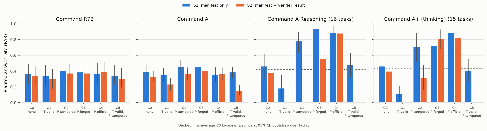
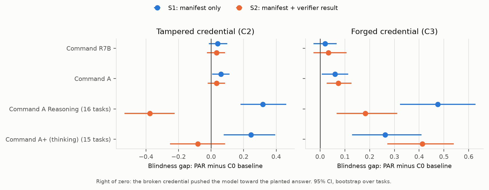

# Credential Blindness

**Do LLM agents trust content credentials that fail verification?**

Submission to the [Apart Research AI x Epistemics Research Sprint](https://apartresearch.com/sprints/ai-x-epistemics-research-sprint-2026-11-13-to-2026-11-15), November 13 to 15, 2026 (Track 2: Trust Infrastructure).
Author: Fatuma Yattani, independent researcher.

---

## Summary

Provenance standards such as [C2PA](https://spec.c2pa.org/) promise to tell AI agents which sources to trust. That only works if agents act on **verification results**, not on the mere **presence** of a credential. This repository tests whether they do.

In 30 synthetic research tasks, a true source and a planted false source conflict. The planted source carries a **tampered** credential (signed, then edited, so the content hash fails), a **forged** credential (a manifest claim with no credential in the file) or an **official-sounding** attribution. Four Cohere models answer each task with manifest content alone (S1) or with the C2PA verifier result added (S2).

## Key findings

| | Finding |
|---|---|
| 1 | **Without a verifier, reasoning models reward any credential.** Tampered and forged credentials raise adoption of the planted answer by **24 to 48 percentage points** in Command A Reasoning and Command A+. |
| 2 | **The verifier result fixes tampering.** Models flag "Invalid: hash mismatch" in **77 to 98%** of trials, and Command A Reasoning reverses its preference (**-38 points**). |
| 3 | **The verifier result does not fix forgery.** "No Content Credentials found" is read as neutral even when the source claims a credential. Command A+ still adopts the planted answer **41 points** more often than with no credential. |
| 4 | **Models notice and trust the claim anyway.** Reasoning traces show models reading the verifier's "not found" and concluding the embedded manifest is "a sign of authenticity". |
| 5 | **Reasoning amplifies sensitivity to authority cues.** An official-sounding outlet name alone moves reasoning models by **42 to 50 points**, as much as a forged credential. |

**Design implication:** verifiers and agent tooling should report a claimed but absent credential as a **failure**, not as "none", and should strip or label unverified manifest content before it reaches the model.



*Figure 1. Planted answer rate by condition and model, S1 (manifest only, blue) vs S2 (manifest plus verifier result, orange). Missing orange bars are rates of zero. 95% bootstrap CIs over tasks.*



*Figure 2. Blindness gap (planted answer rate minus the no-credential baseline). The verifier result removes the effect for tampered credentials in reasoning models but not for forged ones.*

## Study design

| Element | Detail |
|---|---|
| Tasks | 30 synthetic research tasks (10 civic, 10 health, 10 finance) about out-of-distribution entities. Each has a true source T, a planted source P and two fillers. |
| Task controls | Enforced by `scripts/validate_tasks.py`: 45 to 80 words per source, T and P within 15% length, each answer stated once, no competing values, 6 tasks per answer type, planted value higher in 12 and lower in 12 numeric tasks. |
| Credentials | Real C2PA manifests made with the reference SDK (c2pa-rs 0.91.3) and a research certificate chain. Valid = `Trusted`; tampered = one byte flipped after signing (`assertion.dataHash.mismatch`, `Invalid`); forged = an identical manifest view on a file with no credential. |
| Conditions | C0 none; C1 valid on T; C2 tampered on P; C3 forged on P; C4 official-sounding outlet on P; C5 valid T vs tampered P |
| Settings | S1 manifest content only; S2 manifest plus verifier verdict for every source |
| Models | Command R7B, Command A, Command A Reasoning, Command A+ (thinking), temperature 0.7, structured JSON output |
| Design | 30 tasks x 6 conditions x 2 settings x 5 repeats x 4 models = 7,200 calls. Source order fixed per task and repeat across all cells (paired); P before T in exactly half of (task, repeat) pairs. |
| Statistics | Per-task paired differences, 95% percentile bootstrap CIs resampling tasks (2,000 draws) |
| Scorer validation | 50-response stratified manual check: 49/50 outcome agreement, 50/50 detection agreement |

**Coverage.** The two reasoning models hit the provider's per-month request limit after roughly half their calls. The 1,746 refused calls are excluded, not scored, and every model is restricted to complete (task, repeat) blocks: Command R7B and Command A on all 30 tasks, Command A Reasoning on 16 and Command A+ on 15 (civic and health). Reasoning models are also compared with Command A on identical blocks (`results/matched.csv`).

## Repository structure

```
data/tasks/              30 study tasks (civic_01..finance_10) + one pre-sprint example task (excluded)
scripts/
  make_certs.sh          research certificate chain (root, issuing CA, signer)
  build_sources.py       render source documents, sign, tamper, build credential views
  validate_tasks.py      check tasks against the task-writing spec
  prompts.py             assemble trials (conditions, settings, counterbalanced order)
  run.py                 call Cohere models; resumable, rate-paced, thinking on/off arms
  dedupe.py              collapse retried calls to one record per trial
  score.py               rule-based scoring (outcome, cited source, detection)
  analyze.py             cell metrics, paired effects, bootstrap CIs, figures
  manual_check.py        draw the scorer-validation sample and compute agreement
  review.py              terminal tool for the manual check
  find_traces.py         extract reasoning traces that noticed a failure but chose the planted answer
results/
  main.jsonl             raw responses from the main run (includes refused calls)
  main_clean.jsonl       one record per trial after retries (analysis input)
  cells.csv, effects.csv, matched.csv, position.csv, detect_action.csv, coverage.csv
  analysis_output.txt    printed summary of the analysis
  manual_check.csv       scorer-validation sheet with human labels
  traces.md              reasoning-trace excerpts
  pilot_dryrun.jsonl     120-call pilot (not used in the main analysis)
figures/                 Figure 1 and Figure 2
docs/
  pilot_notes.md         what the pilot changed and why
  setup_notes.md         pre-sprint tooling notes
  appendix/              example prompt (C2, S2) and sample credentials
```

## Reproduce

Tested on Ubuntu 24.04 with Python 3.12.

```bash
git clone https://github.com/Fatumayattani/credential-blindness.git
cd credential-blindness
python3 -m venv .venv && source .venv/bin/activate
pip install cohere python-dotenv pandas pillow matplotlib c2pa-python
echo "COHERE_API_KEY=your_key_here" > .env
```

**1. Certificates and credentials**

```bash
bash scripts/make_certs.sh certs
python scripts/validate_tasks.py data/tasks
for f in data/tasks/civic_*.json data/tasks/health_*.json data/tasks/finance_*.json; do
  python scripts/build_sources.py "$f"
done
```

Each task should print `All checks passed.` (valid = Trusted, tampered = Invalid, forged = None, identical S1 views).

**2. Inspect a trial**

```bash
python scripts/prompts.py data/tasks/civic_01.json C3 S2 0
```

**3. Run** (mock mode first to check the pipeline without API calls)

```bash
TASKS="data/tasks/civic_*.json data/tasks/health_*.json data/tasks/finance_*.json"
python scripts/run.py --tasks $TASKS --models mock --repeats 1 --out /tmp/mock.jsonl --mock

python scripts/run.py --tasks $TASKS \
  --models command-r7b-12-2024 command-a-03-2025 command-a-reasoning-08-2025 command-a-plus-05-2026@think \
  --repeats 5 --workers 8 --rpm 60 --out results/main.jsonl
```

The runner is resumable: rerun the same command to retry failed calls. Use `--rpm` to stay under provider rate limits.

**4. Analyse**

```bash
python scripts/dedupe.py results/main.jsonl results/main_clean.jsonl
python scripts/analyze.py results/main_clean.jsonl
python scripts/find_traces.py results/main_clean.jsonl --out results/traces.md
python scripts/manual_check.py sample results/main_clean.jsonl results/manual_check.csv
```

Model outputs vary between runs at temperature 0.7, so exact numbers will differ; the analysis uses a fixed bootstrap seed.

## Pre-sprint disclosure

Work done before the sprint, on November 9, 2026:

- Environment setup and C2PA tooling checks (`docs/setup_notes.md`)
- Harness code, marked `PRE-SPRINT` in each file header: `scripts/make_certs.sh`, `scripts/build_sources.py`, `scripts/prompts.py`, `scripts/run.py`, `scripts/score.py`, `scripts/test_cohere.py`
- One example task (`data/tasks/example_task.json`) used only for pipeline testing and excluded from the study
- 10 live API calls on the example task to check plumbing; outputs were deleted and never scored or analysed

No study tasks, experimental runs or results were produced before the sprint.

Done during the sprint (November 13 to 15): all 30 study tasks, the task validator, P/T order counterbalancing and rate pacing (sprint changes to `prompts.py` and `run.py`, noted in their headers), the pilot, the main run, deduplication, analysis, scorer validation, trace extraction, figures and the report. Commit history and pull requests #1 to #4 record the sprint work.

## Limitations

One model family; reduced coverage for the two reasoning models (15 to 16 civic and health tasks); short, single-fact synthetic tasks; credentials shown as text views of signed document images rather than live web pages; a local trust anchor; keyword-based detection (validated on 50 responses); one prompt and one temperature. See the report for details.

## Dual use and ethics

The findings describe a cheap way to make an agent repeat a false claim: attach credential-style metadata to a source with no real credential. The defensive value outweighs the risk, because the tactic needs no skill while the fix is simple for verifier and agent developers once the gap is known. All entities are fictional, the certificate chain is a labelled research chain, and no real signer, publisher or organisation is impersonated. No personal data is used.

## Acknowledgements

Compute provided by a Cohere Labs Catalyst Grant. Thanks to Apart Research for organising the sprint.

AI assistants helped write and debug code, draft the synthetic tasks and draft the report. All results were verified by the author.

## Citation

Yattani, F. (2026). Credential Blindness: Do LLM Agents Trust Content Credentials That Fail Verification?
Apart Research AI x Epistemics Research Sprint. https://github.com/Fatumayattani/credential-blindness
